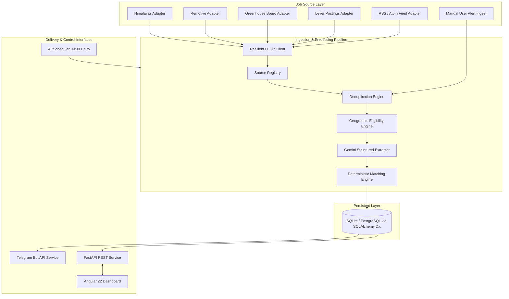

# Job Hunter Agent — Architecture & Technical Specifications

**Version:** 1.0.0  
**Target Candidate Profile:** Software Engineer / Web Developer (Angular / Frontend priority)  
**Location Base:** Egypt (EG)  
**Timezone:** Africa/Cairo (IANA)  

---

## 1. Architectural Philosophy

Job Hunter Agent is designed as a **production-minded modular monolith** with a dedicated worker/scheduler runtime. It enforces three core engineering principles:

1. **Deterministic Over Generative Scoring:** All candidate fit evaluation (0–100) is executed via explainable, auditable pure-Python rules. Large Language Models (Gemini) are strictly restricted to structured attribute extraction from untrusted job text.
2. **Geographic Honesty:** The system never conflates "Remote" with "Worldwide". Remote hiring boundaries, regional ambiguities (EMEA, MENA, Africa), and on-site relocation requirements are classified into an explicit 6-state domain enum.
3. **Source Transparency & Compliance:** The application uses official, public, read-only career APIs (Himalayas, Remotive, Greenhouse boards, Lever postings, and RSS feeds). It never bypasses CAPTCHAs, simulates logins, or scrapes protected boards.

---

## 2. Component Architecture

---

## 3. Data Model & Entity Relationships

- **CandidateProfile:** Stores candidate facts with strict separation between `confirmed_skills` (verified from CV), `target_skills` (learning goals), and `learning_or_exposure_skills`. Target skills **never** inflate confirmed-skill scoring.
- **Source & SourceSyncLog:** Tracks registered providers, policy URLs, attribution requirements, sync status, and execution metrics.
- **Job:** Normalized job posting capturing raw location, eligibility classification, deterministic match breakdown, publication date vs discovery date, and canonical URL hash.
- **DailyRun:** Enforces database-level idempotency with `run_key = daily-digest-YYYY-MM-DD` in `Africa/Cairo` time.
- **NotificationLog:** Records transmitted Telegram message IDs preventing redundant alerts.
- **JobStatusTracker & ApplicationNote:** Tracks opportunity lifecycle (Discovered, Saved, Interested, Applied, Interview, Offer, Rejected, Archived) without automatic application submission.

---

## 4. Matching & Scoring Engine (0–100)

| Dimension | Max Points | Evaluation Logic |
|---|---|---|
| **Role-Family Relevance** | 20.0 | Title contains Angular (20), Frontend/UI (18), Software Engineer/Web Developer (15), description mentions Angular (14) or Frontend (10). |
| **Confirmed Skills Overlap** | 25.0 | Proportional overlap of candidate's `confirmed_skills` against job requirements. **0 points if candidate profile has no confirmed skills verified yet.** Target skills earn 0 confirmed points. |
| **Experience & Seniority** | 20.0 | Graduate/Entry/Junior (18), Mid/Associate (14), Senior/Lead (6). Flags conflict if job requires current enrollment while candidate is a university graduate. |
| **Workplace & Location** | 20.0 | Egypt-eligible on-site/hybrid/remote (20), Worldwide remote (19), Regional remote (12), Relocation required (8), Ineligible (0 with score capped at 40). |
| **Employment Type Fit** | 10.0 | Full-time (10), Contract/Internship (8), Part-time (6). |
| **Freshness & Source Evidence** | 5.0 | Published ≤3 days ago (5), ≤14 days ago (4), older or unstated (2–3). |

---

## 5. Security & SSRF Defense

- **URL Validation:** All external requests validate against private/loopback IP ranges (`127.0.0.0/8`, `10.0.0.0/8`, `192.168.0.0/16`, `172.16.0.0/12`, `localhost`).
- **Prompt Injection Defense:** Job descriptions are wrapped in `<untrusted_job_posting>` blocks, disarmed of command strings, and passed to Gemini with `temperature=0.0` and schema validation.
- **PII Scrubbing:** Candidate emails, phone numbers, and physical addresses are redacted locally before any external transmission.
- **Telegram Single-User Authorization:** Enforces numeric `TELEGRAM_OWNER_ID` allow-list. Unauthorized users are blocked from viewing any data.
