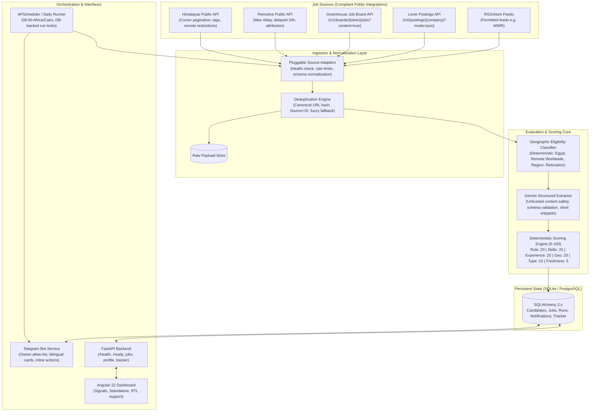

# Job Hunter Agent — Implementation Plan

**Version:** 1.0.0  
**Date:** 2026-11-13  
**Target Candidate:** Software Engineer / Web Developer (Angular / Frontend priority)  
**Location Base:** Egypt (EG)  
**Daily Schedule:** 09:00 Africa/Cairo  

---

## 1. Executive Summary & Architecture Overview

Job Hunter Agent is a production-minded personal job discovery, evaluation, and tracking system built with a **Telegram-first delivery flow** and an accompanying **Angular dashboard**. It prioritizes **accuracy, source transparency, geographic eligibility correctness, and explainable deterministic matching** over collecting high volumes of unqualified jobs.

### System Architecture Diagram

---

## 2. Source Integration Matrix & Compliance Terms

| Source | Integration Type | Official Documentation / Policy URL | Rate Limits & Ingestion Cadence | Attribution & Terms Summary | Fields Provided |
|---|---|---|---|---|---|
| **Himalayas** | Public REST API | `https://himalayas.app/jobs/api` | Cursor pagination; max 1 req/sec; daily fetch | Link back with original `applicationLink`; retain Himalayas source credit; remove expired listings | `title`, `companyName`, `locationRestrictions`, `employmentType`, `seniority`, `minSalary`, `maxSalary`, `currency`, `pubDate`, `applicationLink`, `guid`, `description` |
| **Remotive** | Public REST API | `https://remotive.com/api-documentation` | Recommended max 4 requests/day; 24h delayed feed | Must link back to Remotive URL; credit Remotive; no resale/submitting to 3rd party job aggregators | `id`, `url`, `title`, `company_name`, `category`, `tags`, `job_type`, `publication_date`, `candidate_required_location`, `salary`, `description` |
| **Greenhouse** | Public Board API | `https://boards-api.greenhouse.io/v1/boards/{board_token}/jobs` | Standard REST; GET requests without auth; 10 req/min backoff | Public career board read-only endpoint; company token required; direct link to application | `id`, `title`, `location`, `updated_at`, `absolute_url`, `content` (HTML description) |
| **Lever** | Public Postings API | `https://api.lever.co/v0/postings/{company_id}?mode=json` | REST GET; 10 req/min backoff | Read-only posting API; company slug required; direct link to hosted URL | `id`, `text` (title), `categories` (location, commitment, team), `createdAt`, `hostedUrl`, `descriptionPlain` |
| **RSS/Atom** | RSS 2.0 / Atom 1.0 XML | Standard syndication (e.g. We Work Remotely) | 1 req/hour per feed; conditional GET (`ETag`, `If-Modified-Since`) | Link to original publication URL; attribute feed provider | `title`, `link`, `description`, `pubDate`, `guid` |

### Non-Public / Restricted Sources Documentation

- **LinkedIn, Wuzzuf, Indeed, Bayt, GulfTalent, Naukrigulf, Wellfound, Remote OK**:
  - None of these platforms offer unrestricted public search APIs without business partnerships, signed enterprise contracts, or strict anti-scraping terms.
  - In compliance with Rule 5, this application **never executes unauthorized scraping, bypasses CAPTCHA, or simulates user logins**.
  - **Extension path supported:** The system exposes an email/webhook ingestion endpoint (`POST /api/v1/jobs/ingest/user-alert`) where the user can forward official job alert emails or supply manually exported RSS feeds.

---

## 3. Risks & Mitigations

| Risk | Impact | Mitigation Strategy |
|---|---|---|
| **Geographic misclassification** (e.g. "Remote" assumed worldwide) | Candidate applies to jobs where Egypt is excluded or work authorization fails | Explicit 6-state enum (`EGYPT_ELIGIBLE`, `REMOTE_WORLDWIDE`, `REMOTE_REGION_POSSIBLE`, `RELOCATION_REQUIRED`, `NOT_ELIGIBLE`, `UNKNOWN`). EMEA/MENA marked as region-possible unless Egypt is verified. |
| **Prompt Injection via job postings** | Attacker crafts JD to hijack LLM system prompt or exfiltrate data | Gemini extraction prompt strictly fences JD into an untrusted content block; temperature=0.0; schema enforced via strict Pydantic parsing; no tools or internet access given to LLM call. |
| **Duplicate / Unchanged Job spam** | Telegram digest spammed with the same job every day | Two-tier deduplication: (1) Source + Source ID, (2) Canonicalized URL hash (stripping UTM/trackers), (3) Fuzzy company+title. Only `new_to_agent` jobs sent in daily digest. |
| **API rate limit or IP block** | Daily run halts prematurely | Isolated per-source failure isolation; exponential backoff with jitter; respect `Retry-After`; a failure in Remotive never blocks Himalayas or Greenhouse. |
| **Timezone & Missed Runs** | Candidate misses morning digest or duplicate digest sent on restart | IANA timezone `Africa/Cairo` with DST support; database-backed daily run lock with unique run date key (`daily-digest-YYYY-MM-DD`); catch-up mechanism runs safely if missed. |
| **Privacy / CV leakage** | Sensitive personal details sent to external APIs | CV parsed locally with regex/heuristics; email, phone, street address stripped before LLM; explicit user confirmation before any Gemini call. |

---

## 4. Phased Implementation Roadmap

- [x] **Phase 0:** Repository inspection, environment verification, live API verification, architecture and implementation plan.
- [ ] **Phase 1:** Core backend foundation: FastAPI, settings, SQLAlchemy 2.x async engine, Alembic migrations, unified models, and health endpoints.
- [ ] **Phase 2:** Source adapter framework, registry, rate limiters, and live-tested adapters (Himalayas, Remotive, Greenhouse, Lever, RSS).
- [ ] **Phase 3:** Candidate profile store, Gemini structured extractor with safety guardrails, geographic eligibility classifier, and deterministic 0–100 matching engine.
- [ ] **Phase 4:** Telegram bot integration: typed async client, owner allowlist authorization, bilingual cards (Arabic RTL support + English titles), and inline callback actions.
- [ ] **Phase 5:** Daily scheduler: 09:00 Africa/Cairo execution, DB run lock, idempotency, missed run recovery, notification logging, zero-results report.
- [ ] **Phase 6:** Docker containerization, Docker Compose, CI workflow, security hardening, full automated test suite.
- [ ] **Phase 7:** Angular 22 dashboard: standalone components, Signals, Arabic RTL support, job explorer, profile manager, and application tracker.

---

## 5. Acceptance Checklist

- [ ] Repository contains zero hard-coded secrets; `.env.example` has placeholder keys only.
- [ ] Alembic migrations apply cleanly from empty SQLite/PostgreSQL to latest schema.
- [ ] Source adapters gracefully handle timeouts, 429 rate limits, and schema anomalies.
- [ ] Geographic eligibility engine accurately classifies Egypt on-site, remote worldwide, EMEA/MENA ambiguity, relocation-required, and explicit exclusions.
- [ ] Matching engine calculates deterministic 0–100 scores across the 6 approved dimensions without attributing target skills as confirmed skills.
- [ ] Daily digest executes at 09:00 Africa/Cairo with unique idempotency keys preventing duplicates on restart.
- [ ] Telegram bot enforces numeric owner allowlist; unauthorized users are rejected.
- [ ] Angular dashboard provides responsive, accessible, RTL-ready interface without replicating matching rules in frontend.
- [ ] 100% of automated tests pass without regressions.
